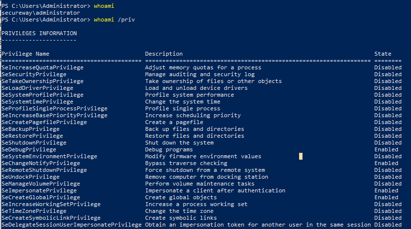
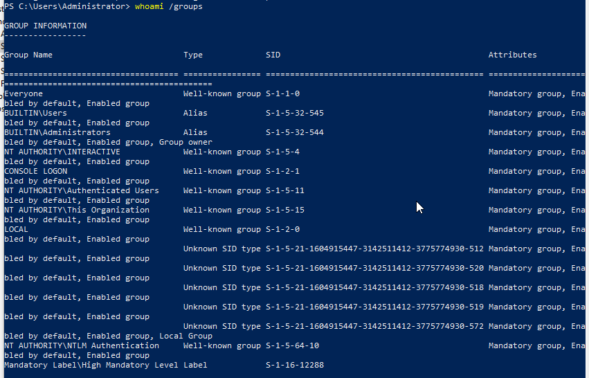
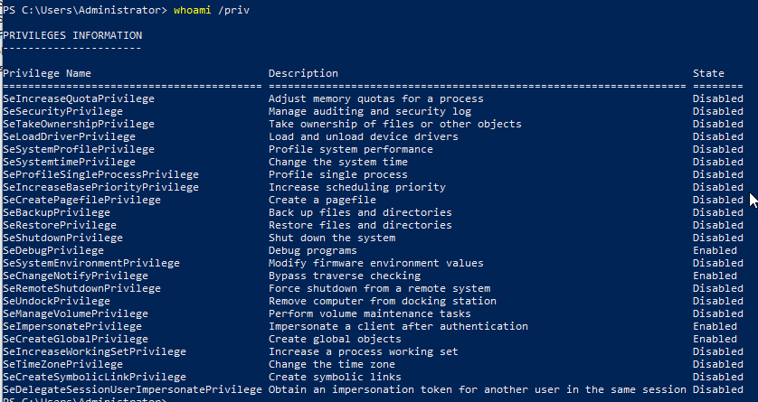

# Windows Identity

## What is an Identity?
An identity is the unique representation of a user, computer, service, or application that Windows can recognize and authenticate.
An identity is not a password or a username. It is the complete object Windows uses when making security decisions.
Windows identities can represent:
- Human users
- Computers
- Services
- Applications
- Groups (for authorization)
  
## Why it exists? 
Windows separates identity from credentials because credentials can change while identity remains the same.

## Identity vs Username
A username is not the actual identity used internally by Windows.

Internally, Windows identifies accounts using a Security Identifier (SID). A username can change, but the SID remains the same.

This allows Windows to consistently recognize an identity even if the displayed username changes.

## Why Identity Matters to Defenders
Most attacks eventually involve an identity.

Examples include:

- Password spraying
- Brute force attacks
- Pass-the-Hash
- Kerberoasting
- Lateral movement
- Privilege escalation

Understanding identities helps defenders determine:

- Who authenticated?
- How was authentication performed?
- Which account was targeted?
- Was the activity expected?
- Which systems were accessed?


## Hands-on Observations
### Objective

Observe the currently authenticated identity in Windows.

### Command

```cmd
whoami
```

```cmd
whoami /priv
```
```cmd
whoami /groups
```

### Screenshot





### Observation

The `whoami` command displays the identity currently authenticated on the system in the format `COMPUTERNAME\Username`. This allows an analyst to quickly determine which account is associated with the current session.

The `whoami /groups` command display the membership in access tokens

The `whoami /priv` command shows the privileges in the access tokens

### Defender's Note

During an investigation, this command helps verify the active user on a compromised host and correlate the identity with security events recorded in Windows Event Logs.

## Key Takeaways
- Identity represents who an entity claims to be.
- Credentials prove an identity.
- Authentication verifies identities using credentials.
- Usernames are human-readable labels.
- Windows internally tracks identities using Security Identifiers (SIDs).
- Understanding identity is fundamental for authentication, Active Directory, and cloud IAM.
