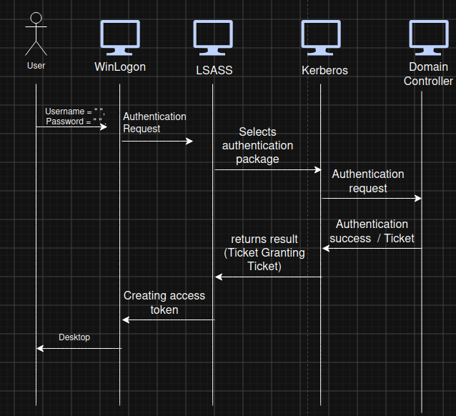

# LSASS (Local Security Authority Subsystem Service)

## Overview
LSASS (Local Security Authority Subsystem Service) is a core service that acts as a user-mode process that is responsible for Windows Authentication.
More specifically, it maintains the local security policy database, verifies user credentials, and manages access tokens that determine what resources users can access. 

This Process functions within several security concepts: 
- Authentication: represents the process of verifying a user's identity through credentials. LSASS.exe coordinates this verification process whether credentials are checked locally or against domain controller
- Kerberos and NTLM: These are the two main authentication protocols in Windows environments. Kerberos provides ticket-based authentication for domain environments, while NTLM handles legacy authentication.
- Credentials: encompass various forms of identity proof including plaintext passwords, password hashes, Kerberos tickets, and access tokens.
- Security Subsystem: Refers to the collection of Windows components responsible for enforcing security policies, user rights management, and access control to system resources. 
  
## Simplified Authentication Flow

1. The user submits credentials through the Windows logon interface.
2. Winlogon forwards the authentication request to LSASS.
3. LSASS invokes the appropriate authentication package (Kerberos for domain authentication).
4. After successful authentication, LSASS creates an access token representing the user's identity and privileges.
5. Windows starts the interactive user session and loads the desktop.

## Why Attackers Target LSASS
If abused, LSASS converts local admin into lateral movement. Attackers often land on a workstation with only a low-privileged foothold. 
Once they get local admin rights, they can read LSASS memory. Stolen hashes and tickets work without cracking anything. NTLM and Kerberos both accept proof from hash or key. 

## Defender's Perspective

Because LSASS contains authentication material and creates access tokens, it is one of the most closely monitored Windows processes.

Common defensive considerations include:

- Monitoring for unauthorized access to LSASS memory.
- Detecting credential dumping attempts.
- Verifying that lsass.exe runs from its legitimate location.
- Correlating LSASS-related telemetry with EDR and Sysmon alerts.

  
## Key Takeaways
- LSASS is the central security authority for Windows authentication.
- It coordinates authentication through Kerberos or NTLM.
- Successful authentication results in the creation of an access token.
- Because LSASS stores sensitive authentication material, it is a high-value target for attackers and a critical process for defenders to monitor.
