## Kerberos Authentication

# What is Kerberos? 
Kerberos is a network authentication protocol used mainly in Windows domains to let users prove they are once, then access multiple services without sending their password each service.
Its job is to solve this problem: 
In a domain environment, a user may need access to many resources: file shares, printers, servers,  databases. Kerberos lets the user authenticate secuely to the domain and then reuse cryptographic tickets instead of repeatedly entering credentials. 

# Why Kerberos Exists? 
Kerberos is a network authentication protocol used mainly in Windows domains to let users prove they are once, then access multiple services without sending their password each service.
Its job is to solve this problem: 
In a domain environment, a user may need access to many resources: file shares, printers, servers,  databases. Kerberos lets the user authenticate secuely to the domain and then reuse cryptographic tickets instead of repeatedly entering credentials. 
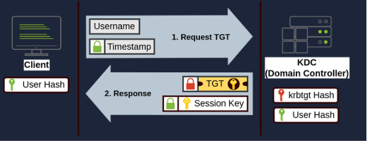

# Core Components
Main Components
- Client – The user’s workstation
- KDC (Key Distribution Center)- Usually on the Domain Controller
KDC issues tickets. It has two logical parts:
  1. AS (Authentication Service) – issues the first ticket
  2. TGS (Ticket Granting Service) – Issues service tickets.
- TGT (Ticket Granting Ticket) - A ticket that proves the user already authenticated to the domain
- TGS (Service Ticket) – A ticket used to access one specific service, like: 
1.	File share
2.	SQL server
3.	Web app 
4.	Printer service

# Kerberos Authentication Flow and Wireshark Packet analysis
When you send authentication request for logging in to your Windows workstation,
you computer send AS-REQ to Domain Controller.
It contains Username, Timestamp, Supported Encryption Types, Pre-authentication data.
How does Windows prove you know your password without sending it? 
This is where pre-authentication comes in. Your password is converted into cryptographic key. 
That key encrypts a timestamp. The DC decrypts it using the stored password-derived key.
Security benefits comes from that the password never traverses the network in plain text. The next action in the DC side is AS-REP which is authentication service reply. If authentication succeeds, the Domain Controller returns AS-REP. This contains two important items.

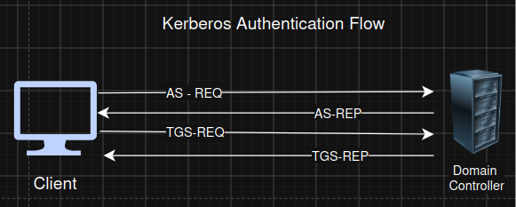

1.	TGT – Ticket Granting Ticket. 
2.	Session Key – Used later
   
TGT helps to prove identity only once instead of repeatedly while using multiple services which normally would require authentication. In addition, it is not possible to read TGT key as it is encrypted with KRBTGT account’s secret key. Only KDC can decrypt it.  
TGT contains information such as Username, Domain , Groups, SID, Authentication time, Expiration time, PAC, and Session key. 
TGS-REQ - Now you want to access \\fileserver\HR. Your computer sends TGS-REQ to the KDC. Included TGT , Authenticator, Desired Service. 
Ex: cifs\fileserver.company.local
KDC knows you are authenticated according to your valid TGT given previously. 

# SPN – Service Principal Name.
Every Kerberos-enabled service has an SPN. Example: 

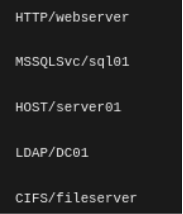

More simply SPN is a unique identifier of service in Active Directory.
TGS-REP 
The Domain Controller responds : TGS-REP containing a Service Ticket. This ticket in encrypted using the target service account’s key , so only that service can decrypt.

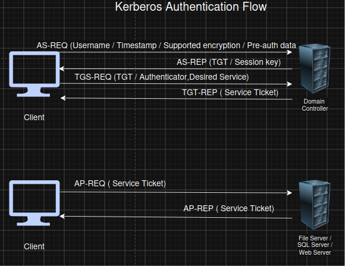

To fully understand how Kerberos works, i have tried to send AS-REQ,AS-REP requests to Windows Server 2022 from Windows 10 client in my virtual machine. I have put them to same internal network subnet, assigned IP addresses, and inserted the Windows 10 client to secureway.local AD domain. 

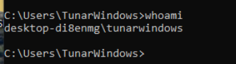

**Domain Controller
**

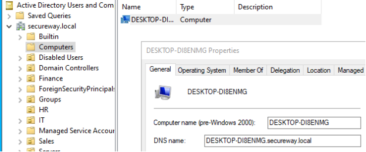

As can be seen, windows client is already been joined to our AD of Computers OU.
Now, we will work with Wireshark , network analyzer tool , in order to clearly understand how Kerberos requests actually look like in real environment.  For this reason, i will set up Wireshark in client computer.
I logged in as AD domain user to secureway.local from client.

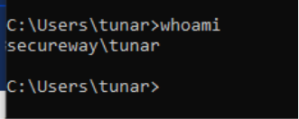

Note that joining computer to AD does not create an account for us to login as AD user.
We have to manually create an user with credentials in USERS OU and log in from client workstation with these credentials for further processing. 
After setting up Wireshark on Domain Controller, i signed and created Kerberos requests. It can be clearly seen: 

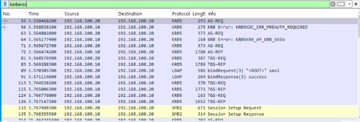

**Deeper packet analysis
**
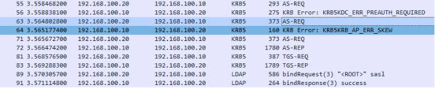

packet 55 (AS-REQ) sends a request to Domain Controller as SECUREWAY\tunar user and requires authentication.
Meanwhile, Windows knows our username,domain, supports several encryption algorithms.
However, it does not how TGT yet.

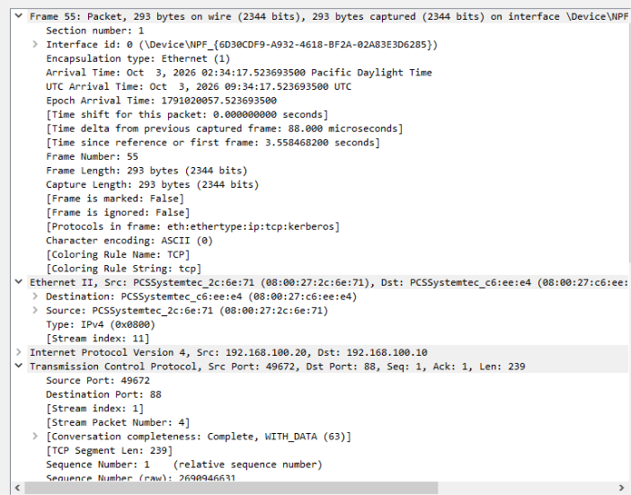

packet 56 (KRB5KDC_ERR_PREAUTH_REQUIRED) shows the KDC requires pre-authentication. Without pre-authentication anyone can could send AS-REQ as “username:Administrator” and Domain Controller would immediately return encrypted data. Attackers abuse that in AS-REP Roasting
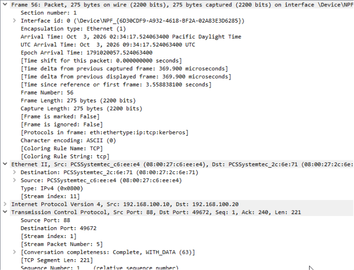

In packet 63 (second AS-REQ) Windows sends another AS-REQ.
This contains username,encrypted timestamp, supported encryption, realm, nonce. 
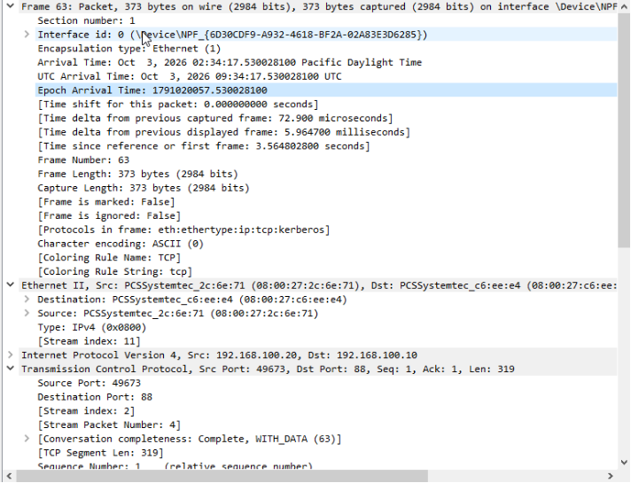

Finally Packet 72 (AS-REP) indicates successful authentication. As we mentioned previously, this packet contains TGT, Session Key, Ticket Lifetime, encryption information.  
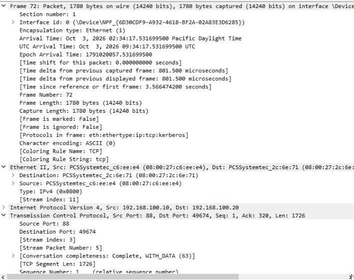

Windows stores TGT in memory.
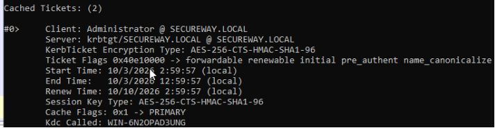
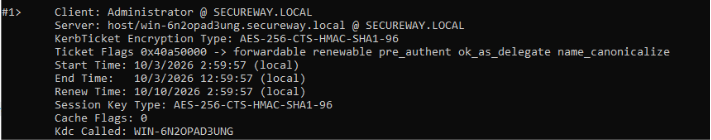

# PAC (Privilege Attribute Certificate)
The Privilege Attribute Certificate (PAC) is a Microsoft-specific data structure embedded inside Kerberos tickets that contains authorization information authenticated user. Simply, it tells what authenticated user is allowed to do. 
Without PAC, the file server would need to ask the Domain Controller every single time.  
The PAC is created by the Key Distribution Center (KDC).
screenshots/PAC-diagram.png

# PAC vs Access Token
table>

# Defender's Perspective
# Common Event IDs
screenshots/kerberos-common-IDs.png

## Key Takeaways

- Kerberos is the default authentication protocol in Active Directory environments and provides mutual authentication using tickets instead of repeatedly transmitting passwords.
- The Key Distribution Center (KDC), running on the Domain Controller, is the trusted authority responsible for issuing Ticket Granting Tickets (TGTs) and Service Tickets.
- Authentication occurs only once during logon. After receiving a TGT, the client requests Service Tickets to access individual network services.
- A single TGT can be used to obtain multiple Service Tickets without requiring the user to enter credentials again.
- After successful Kerberos authentication, LSASS creates an Access Token that Windows uses for all subsequent authorization decisions.
- Kerberos authentication generates valuable forensic artifacts, including Event IDs 4768, 4769, and 4771, which are commonly investigated by SOC analysts.
- Because Kerberos tickets represent authenticated identities, techniques such as Kerberoasting, Pass-the-Ticket, and Golden Ticket attacks make Kerberos one of the most important authentication mechanisms for defenders to understand.

# References
https://learn.microsoft.com/en-us/windows-server/security/kerberos/kerberos-authentication-overview
https://learn.microsoft.com/en-us/previous-versions/windows/it-pro/windows-server-2012-r2-and-2012/hh831553(v=ws.11)
https://medium.com/@araman99/all-about-kerberos-ntlm-authentication-on-windows-systems-42e793afb020
