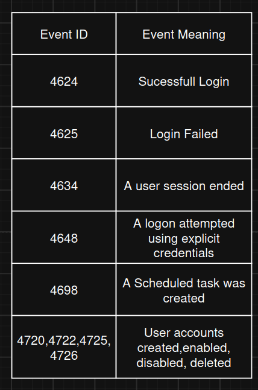
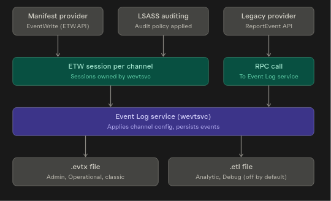
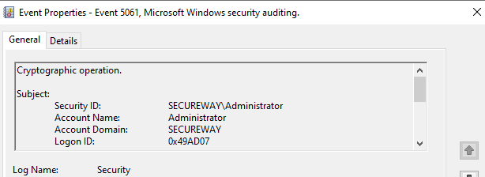
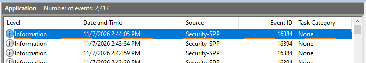
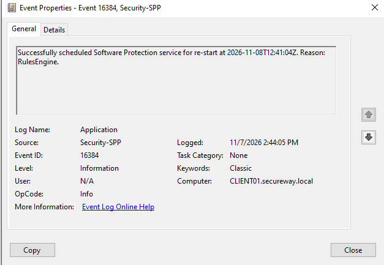

# Windows Event Logging
## Overview
Windows Event Logging is Windows' built-in auditing infrastructure that records security, system, and application activity for monitoring, troubleshooting, compliance, and forensic investigations. Event logs can be used to track system, troubleshoot, and find out some application issues and forecast problems. Windows stores event log in C:\Windows\System32\winevt\Logs\ or can be checked via using Win Key + R > eventvwr. 
## Elements of a Windows Event log
1.	Log name : Name of the event log to which events from different logging components will be written. Events are commonly logged for system, security, and applications. 
2.	Event date / time: includes the date and time when the event occurred. 
3.	Task category: identifies the type of recorded event log
4.	Event ID: Windows stores unique number to differentiate between event types and specific logged event.
5.	Source: Name of the program or software triggering event log
6.	Level. : Event level represents the severity of the recorded log. 
7.	User : name of the user who logged onto the Windows computer when the event occurred.
8.	Computer : name of the computer logging the event. 
## Common event log categories
1.	System logs – Windows system event log contains events related to the system and its components. 
2.	Application log – Events related to software or application hosted on Windows OS. 
3.	Security – this log contains events related to safety of system such as failed or successful logins, type of user logged in , file deletions, or unauthorized access attempts. 
4.	Setup – the setup log contains events that occur during installation of the Windows OS. 
5.	Forwarded events – contains event logs forwarded from other computers in the same network

##Common Event IDs

## Windows Event Logging Workflow

## Defenders Perspective
Windows Event Logs are one of the primary sources of evidence during security investigations. When a security incident occurs, defenders use these logs to reconstruct the sequence of events that led to the incident. Rather than analyzing a single event in isolation, SOC analysts correlate multiple events across different log categories to build a timeline of attacker or user activity.
For example, a successful logon event (Event ID 4624) can be correlated with subsequent process creation, service modifications, or application events to determine what actions were performed after authentication. This enables defenders to identify the root cause of an incident, assess its impact, and support incident response and forensic investigations
In enterprise environments, Windows Event Logs are typically forwarded to a Security Information and Event Management (SIEM) platform such as Microsoft Sentinel, Splunk, or Elastic Security, where events from multiple endpoints can be centrally monitored, correlated, and analyzed.

## Hands-on Investigation

In this lab , i investigated whether native Windows Event Viewer actually provide enough evidence to reconstruct a user authentication session. I tested Security and Application categories and compared succesfull and failed logon along with Event IDs and account information..  The output in the Event viewer’s security log is as follows: 

We can also get further information by clicking on Event name and see detailed information about from which account and when the attempt was conducted: 

Windows Event Log Application logs example: 
We can also investigate logs and issues regarding applications in Windows environment. 

And by clicking on Information , we can get more information such as reason of log, source, log time, computer and User along with event ID.

## Lessons Learned
During this investigation I observed that:
- Native Windows Event Logs provide excellent visibility into authentication events.
- Event Viewer is only a visualization tool; logs are stored separately as EVTX files.
- Without additional auditing or Sysmon, process execution visibility is limited.
- Security investigations depend on correlating multiple events rather than analyzing a single event in isolation.

## References
https://www.solarwinds.com/resources/it-glossary/windows-event-log
https://learn.microsoft.com/en-us/windows/win32/eventlog/event-logging
https://claude.ai/ – for diagrams and flow visualization
https://chatgpt.com/ – for detailed and clear explanations and deep learning.

