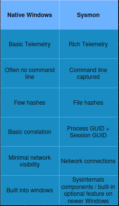
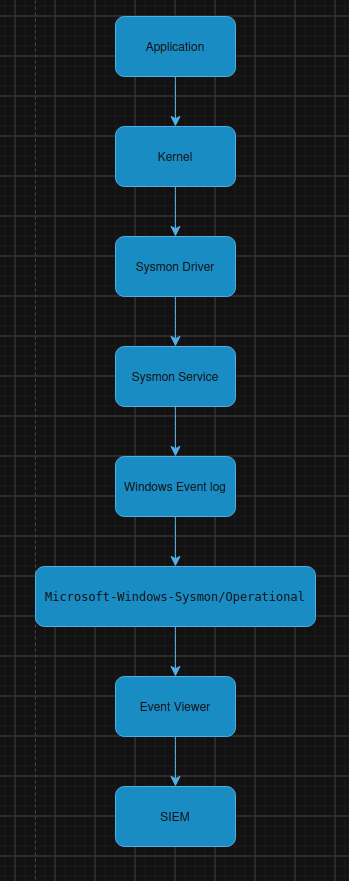
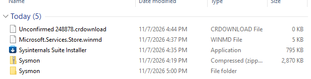
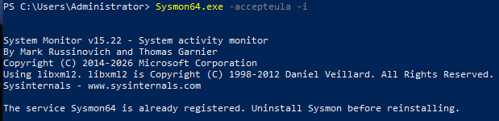
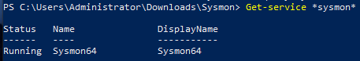
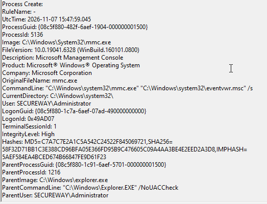
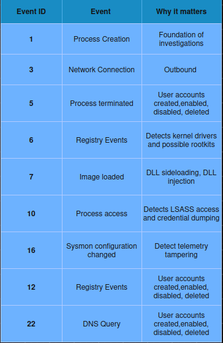

# Sysmon (System Monitor)

## Overview
System Monitor is a Windows system service and device driver that after installation , remains resident across system reboots to monitor and log system acvitity to the Windows event log. It provides detailed information about process creation,s network connections, and changes to file creation time. 
## Why Sysmon exist 
Sysmon (System Monitor) exists because native windows event often lacks of the deep , granular details security analyst and system administrators need to tracth steathy threats,malware, and lateral movement. While default Windows logs show that a process started , they frequently miss crucial context like exact command-line arguments , parent processes , and cryptographic file hashes. 

## Capabilities
·	Logs process creation with full command line for both current and parent processes.
·	Records the hash of process image files using SHA1 (the default), MD5, SHA256 or IMPHASH.
·	Multiple hashes can be used at the same time.
·	Includes a process GUID in process create events to allow for correlation of events even when Windows reuses process IDs.
·	Includes a session GUID in each event to allow correlation of events on same logon session.

## Native Windows Logging vs Sysmon

## Sysmon Architecture
Sysmon follows a layered architecture that continuously monitors system activity and records selected events based on a configuration file.
It consists of four main components. 
 **1.Sysmon Driver** - A kernel-mode driver that observes low-level system activity such as process creation , network connections, and file operations
 **2.Sysmon Service**- A user-mode service that receives telemetry from the driver, evaluates it against the active configuration , and generates events 
 **3.XML Configuration** - Defines which system activities should be logged or ignored, allowing administrators to tune Sysmon for their environment. 
 **4.Windows Event Log** - Stores the generates events under **Applications** and **Service Logs => Microsoft => Windows => Sysmon => Operational** where they can be viewed locally or colltected by SIEM. 
 
 

# Installation
First, we have to download Sysmon from Microsoft Sysinternals and extract from ZIP archive.
 

Then the rest is done using powershell. 
Navigate to directory where Sysmon is installed and start set up and verify it is running. 

 

Next, we should download config file for Sysmon from github repo: 
https://github.com/SwiftOnSecurity/sysmon-config/blob/master/sysmonconfig-export.xml
Verify service is running:
 

## Event Fields

 

**1.	UtcTime**- Time when the process was created . 
**2.	ProcessGUID** – A globally unique identifier 
**3.	ProcessID**– A globally unique identifier assigned by Sysmon to the process
**4.	Image** – Full path to the executable
**5.	CommandLine** – Complete command used to launch the process 
**6.	CurrentDirectory** – Working directory of the process 
**7.	User** – user account that started the process
**8.	 ParentProcessGuid**– GUID of the parent process. This enables reconstruction of the process tree
**9.	ParentProcessID** – PID of the parent process. 
**10.	ParentImage** – Executable that launched the process 
**11.	ParentCommandLine** – Command line of the parent process 
**12.	Hashes** – Cryptographic hashes. Used to identify known malware or verify file integrity

## MITRE ATT&CK Mapping

Event ID 1 is relevant to many ATT&CK techniques because attackers almost always execute the process
T1059  – Command and scripting interpreter 
T1204 – User execution 
T1106 – Native API 
T1569.002 – Service Execution

## Most common Sysmon Event IDs
 

## References
1. https://learn.microsoft.com/en-us/sysinternals/downloads/sysmon
2. https://learn.microsoft.com/tr-tr/sysinternals/downloads/sysmon
3. https://tryhackme.com/room/sysmon

 
